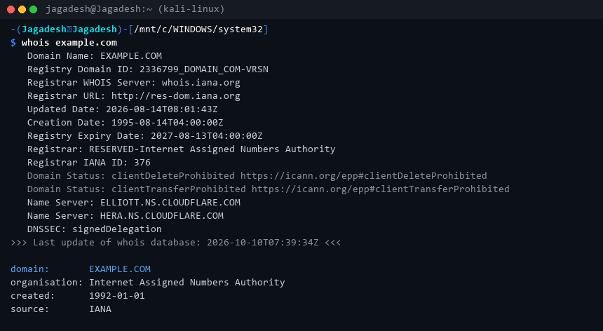

# EXPERIMENT – 16

**Question:** Perform reconnaissance using Google and WHOIS.

### Aim
To gather publicly available information about a website using Google and WHOIS.

### Commands
```bash
Google:
site:example.com

WHOIS:
whois example.com
```

### Output Screenshot (User: Jagadesh)


### Use
Google helps find publicly available website information, while WHOIS displays domain registration details.

### Result
Thus, reconnaissance was successfully performed using Google and WHOIS.
