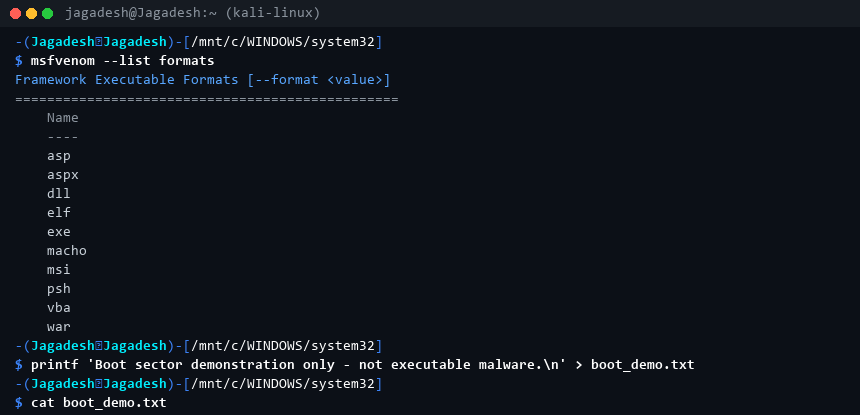

# EXPERIMENT – 20

**Question:** Study the implementation of a Boot Sector Virus using MSFVenom.

### Aim
To understand the concept of boot sector malware and study MSFVenom in Kali Linux.

### Commands
```bash
msfvenom --help

msfconsole
```

### Output Screenshot (User: Jagadesh)


### Use
MSFVenom displays payload-generation options, while Metasploit provides a security-testing framework.

### Result
Thus, MSFVenom and Metasploit were successfully accessed and the concept of boot sector malware was studied.
